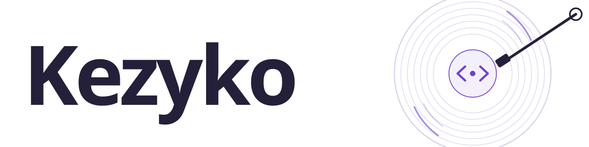

<picture>
  <source media="(prefers-color-scheme: dark)" srcset="./assets/kezyko-dark.svg">
  
</picture>

### Code, on repeat.

I'm **Kezyko** — Keytaroko Putra, a Laravel developer in Indonesia. I build web apps that carry real work: approval chains, inventory, roles, audit trails. When the backend goes quiet I move into the browser instead — computer vision, WebRTC, interfaces that have some personality.

Most of my commits land in private repositories, so the green squares here stay quiet. The work below is what I can show.

- **Building** — Warehouse & inventory platform · Laravel, MySQL, Tailwind
- **Into** — WebRTC, MediaPipe, and anything that makes the browser do more than forms
- **Open to** — Laravel work, web collaborations, music recommendations

### Selected builds

**[FotoCam](https://github.com/kezyko/FotoCam)** — Hand tracking in the browser. Point a phone at yourself, pair it with a QR code over WebRTC, and the video stays peer-to-peer; nothing is uploaded.
`Laravel` `MediaPipe Hands` `WebRTC` `Socket.io` `Tailwind`

**[Expense Approval](https://github.com/kezyko/expense-approval)** — Multi-level expense approval for five roles, with budget and balance checks, document attachments, and an audit trail on every transition.
`Laravel 13` `MySQL` `Bootstrap 5` `Breeze`

→ [All repositories](https://github.com/kezyko?tab=repositories)

### Toolkit

- **Backend** — `PHP 8.3` · `Laravel` · `Blade` · `MySQL` · `Composer`
- **Frontend** — `Tailwind CSS` · `Bootstrap 5` · `JavaScript` · `Vite`
- **Browser** — `MediaPipe` · `WebRTC` · `Socket.io`
- **Workspace** — `Git` · `Linux` · `Figma`

### Say hi

Open an issue on any repository, or start a discussion — I read everything. Music recommendations count as a valid reason to contact me.
